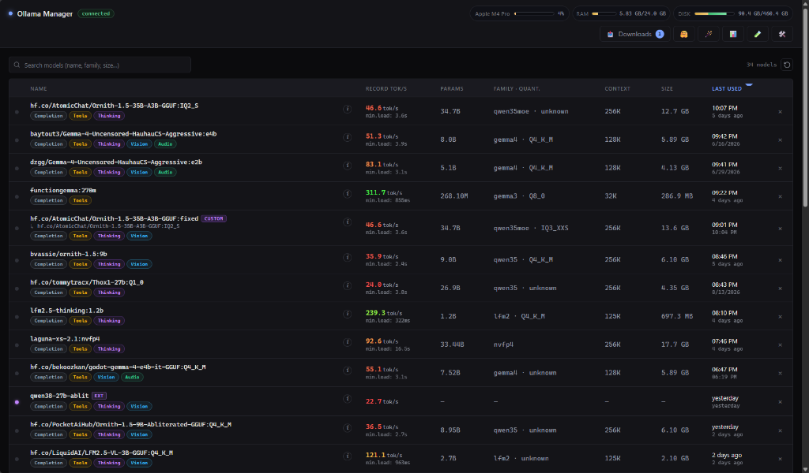

# Ollama-Manager

Tiny, fast, and feature-packed Go web server to manage, benchmark, and interact with [Ollama](https://ollama.com) models and external LLMs. **Features an advanced background download queue manager** to queue, pause, resume, and prioritize multiple model downloads sequentially without saturating your bandwidth — solving one of Ollama's biggest limitations.

Chat with your models through retrieval-augmented **knowledge bases (RAG)**, autonomous **web & artifact agents**, detached **background sessions**, and self-hosted **ComfyUI image generation** — all from a single binary.



## Key Features

- **🚀 Persistent Background Download Queue & Manager**:
  - **Sequential FIFO Queueing**: solves Ollama's limitation of launching concurrent downloads that saturate network bandwidth and disk I/O. Queue as many massive models and Hugging Face GGUFs as you want; they download reliably one by one.
  - **Granular Pause & Resume**: pause and resume individual downloads or freeze the entire queue on demand without losing progress.
  - **Live Speed & ETA Telemetry**: Server-Sent Events (SSE) streaming real-time download speed (MB/s), bytes transferred, percentage, and dynamic estimated time remaining (ETA).
  - **Fault-Tolerant Persistence (`jobs.json`)**: queued, active, and completed jobs survive server or computer restarts automatically.
  - **Full Download Lifecycle Controls**: cancel in-flight jobs, retry failed downloads with one click, view comprehensive download history (durations, timestamps, sizes), and clear completed items.
  - **Single-Click Queueing**: enqueue any model or specific quantization directly from the Hugging Face Explorer, Ollama library, or Model Repair wizard.
  - **Failed Download Recovery**: recover failed Hugging Face downloads (gated repos, interrupted transfers) by previewing which blobs are missing and reusing what was already fetched instead of starting over.

- **Hugging Face Model Explorer & Downloader**:
  - **Live GGUF Search**: search and explore models on Hugging Face directly within the app, filtering by name, architecture, quantization, and parameter size.
  - **Hardware Fit Estimator**: calculates required VRAM and system RAM for every quantization variant based on your machine's hardware, with clear fit indicators before downloading.
  - **Vision Projector (`mmproj`) Detection**: automatically discovers compatible multimodal vision projector files for vision-enabled architectures.
  - **Direct Queue Integration**: send models and projectors straight to the download queue manager with one click.

- **Model Management & Repair**:
  - **Comprehensive Catalog**: real-time list of installed models with family, parameter count, quantization, model size, context length, last used timestamp, record tok/s, and loaded status (VRAM/RAM).
  - **Model Repair & Vision Projector Attach**: inspect, test, and patch community models with missing tool templates, thinking tags, or invalid Markdown stop tokens. Attach `mmproj` vision projectors to add vision capabilities with **proactive disk space verification** before downloading.
  - **Memory & VRAM Management**: unload individual models or unload all active models from VRAM/RAM with one click.
  - **Model Archiving & Uninstall History**: archive rarely used models or review uninstalled models with optional deletion reason notes.
  - **Full Model Inspector**: view raw Modelfiles, Jinja/Go templates, licenses, parameters, and architecture details.

- **External Models Integration (OpenAI-Compatible)**:
  - Connect remote LLM providers (OpenAI, DeepSeek, Groq, OpenRouter, vLLM, LM Studio, etc.) alongside your local Ollama models.
  - Configure custom base URLs, API keys, model identifiers, and custom capability tags (`tools`, `thinking`, `vision`).
  - Use external models across the entire application: chat, web tools, live artifacts, and benchmarks.
  - **Context Length Discovery**: external models report their context window, shown in the model list and used by the live chat context meter to display how much of the context is in use.

- **OpenAI & Ollama API Gateway** (⚙ Settings → Tunneling Models):
  - **Re-Expose Your Models**: run a second, independent listener that serves your selected models (local and external) to third-party clients over both OpenAI-compatible (`GET /v1/models`, `POST /v1/chat/completions`) and Ollama-native (`/api/tags`, `/api/chat`, `/api/generate`, `/api/show`) protocols.
  - **Model Allowlist**: expose every visible model by default, or restrict the gateway to a hand-picked subset.
  - **Bearer API Keys**: require `Authorization: Bearer` with keys generated in Settings — only the hash is stored and the secret is shown once.
  - **Independent Listener**: its own port (default `7861`, must differ from the main port) with optional LAN exposure (`0.0.0.0`).

- **Analytics & Performance Dashboard**:
  - **Speed & Cold Load Telemetry**: track record tokens/second (tok/s) and minimum cold load times for every model.
  - **Historical Usage & Token Counting**: monitor prompt tokens, completion tokens, execution times, and session counts.
  - **Interactive Performance Charts**: visualize model speed comparisons, memory footprints, and efficiency metrics.

- **System Prompts Library & Modelfile Studio**:
  - **Curated Prompt Library**: built-in and user-managed prompt library to store, edit, categorize, and search system personas with instant one-click application to any model or chat.
  - **Visual Modelfile Studio**: interactive 3-step builder to craft custom Ollama models (`FROM`), inject documentation files, estimate token budgets against context limits, and tune advanced parameters (stop tokens, templates, sampling) or edit raw Modelfiles with live syntax highlighting.

- **Rich Web Chat Interface**:
  - **Real-Time Streaming & Telemetry**: Server-Sent Events (SSE) streaming with live tokens/second (tok/s), cold load time, and response generation metrics.
  - **Thinking Traces & Granular Reasoning Control**: collapsible and chronologically structured `<think>` reasoning traces with granular thinking levels (`auto`, `off`, `low`, `medium`, `high`, `max`).
  - **Per-Model Customizations**: customize system prompts, temperature, top-k, top-p, context length, and thinking levels with automatic persistence in `localStorage`.
  - **Multimodal Support**: image generation, vision inputs, audio attachments, and browser microphone voice recording.
  - **Speech Playback**: a `speech` model answers with audio in its own bubble, some models ship several voices to pick from, and the `Speech` switch also reads back what you send with a chat model.
  - **Session Management & Message Editing**: edit previous turns, cancel queued requests to recover inputs, and reset conversations with confirmation.

- **Web Tools & Live Artifacts Agent**:
  - **Web Search & Fetch**: server-side bounded web agent using DuckDuckGo (`web_search`) and direct HTTP (`web_fetch`) with a structured timeline.
  - **Artifacts Workspace Sandbox**: interactive workspace where models build, test, and iterate on full-stack web applications and code (`create_artifact`, `write_file`, `replace_in_file`, `read_file`, `list_dir`, `exec`) with real-time live preview.
  - **Autonomous Visual Inspection (`take_artifact_screenshot`)**: vision-capable models capture and visually inspect rendered previews directly from the browser to fix layouts and styling.
  - **Direct UI Interaction (`eval_artifact_js`)**: models execute JavaScript inside the sandbox to click elements, fill forms, and test event flows.
  - **Console Diagnostics (`get_artifact_console`)**: automatic capture of sandboxed iframe runtime logs (`console.log`, `console.warn`, `console.error`) for autonomous debugging.
  - **Artifact Project History**: browse past generated artifact workspaces by model and date, reload previous projects, or delete them via UI/API.

- **Knowledge Bases (RAG — Retrieval-Augmented Generation)**:
  - **Semantic Search over Your Own Knowledge**: SQLite-backed knowledge bases whose entries are embedded automatically with any installed Ollama embedding model and retrieved by cosine similarity.
  - **Multi-Media Entries**: each entry holds text, images, or audio — embedded either combined with its text or from attachments only — with a descriptive title and aliases/keywords.
  - **Full Base Management**: create, edit, download (the `.db` file), and delete bases; drag-and-drop content upload; import/export; a live character counter; and automatic schema migrations across releases.
  - **External Base Editor**: open and edit a `.db` from disk without installing it into your library, then download it back or save a local copy with fresh embeddings.
  - **Chat Integration**: attach bases per chat, toggle per-base edit permission, and keep chat uploads isolated from the managed library.
  - **Agent Tools**: models can list, read, search, create, update, and delete entries, and rename or re-describe bases (`rag_*` tools), honoring the edit permissions you grant.

- **ComfyUI Image & Video Generation**:
  - **Generation as a Chat Tool**: point the manager at your own ComfyUI server and let the model render images and videos mid-conversation; results land in the transcript with the images attached to the message.
  - **Binding-Scoped Workflows**: register workflows and expose only their declared bindings (prompt, negative prompt, seed, steps, cfg, denoise, width/height, lora, inputs) to the model — everything else stays fixed.
  - **Cross-Turn Iteration**: recent renders are replayed as vision input so the model can critique and refine what it just produced.
  - **Video & Audio Aware**: video and audio outputs are stored and previewed (with a size caption) even though vision models only ever receive images.
  - **Per-Session Media**: renders are stored per session and swept on startup, so deleting a session cleans up its output.

- **Persistent Background Chat Sessions**:
  - **Detached Runs**: sessions run on the server and keep going after you close the tab; reopen, continue, export, or delete them later.
  - **Message Queues**: messages sent while a model is busy are queued, promotable, and never dropped or duplicated.
  - **Capability-Based Tool Gating**: artifacts, web tools, ComfyUI, and RAG tools are enabled only for the models that actually support them, for both local and external models.
  - **At-a-Glance Badges**: running/queued and unread states are visible next to every model in the list, and sessions are scoped to their model.
  - **Configurable Lifecycle** (`chat_sessions`): enable or disable the feature and choose whether uninstalling a model deletes its sessions or keeps them flagged as missing their model.

- **Decision Models (System One) Playground**:
  - **Dedicated Decision Endpoint**: models that expose a `decision` capability get a JSON-in/JSON-out playground backed by Ollama's system-one endpoint, replacing the chat composer.
  - **Input Builder & Image Preview**: build typed decision requests, attach images for vision models, and switch between card and JSON result views.
  - **Decision Metrics**: calls, questions, tokens, and min/avg/max latency are tracked and surfaced in analytics.

- **OpenCode Integration** (⚙ Settings → OpenCode):
  - Manage which installed models appear in your local [OpenCode](https://opencode.ai) configuration (`~/.config/opencode/opencode.json`).
  - Detect or create local Ollama providers, toggle models with custom display names, and export provider blocks for remote machines.

- **Tests & Benchmark Suite**:
  - Built-in benchmark suite to evaluate and compare models against standardized prompts for speed, context processing, and accuracy.

- **Security & Portability**:
  - Single binary, zero external dependencies, minimalist dark UI, and bilingual interface (English / Spanish).
  - Optional bcrypt password protection and HMAC-signed session cookies.
  - **On-Demand Secret Reveal**: Hugging Face and external provider tokens can be revealed in Settings with eye toggles, protected by same-origin checks.

---

## Requirements

- **Go 1.25 or later** (for building from source).
- **Ollama** running locally or remotely (defaults to `http://localhost:11434`).

---

## Build

```bash
# Standard build (embeds VCS metadata automatically)
go build -o ollama-manager .

# Embed version + compilation date/time manually
go build -ldflags "-X 'main.appVersion=v1.0.9' -X 'main.buildTime=$(date +'%F %T')'" -o ollama-manager .
```

### Cross-Compilation

```bash
GOOS=linux   GOARCH=amd64 go build -ldflags "-X 'main.appVersion=v1.0.9' -X 'main.buildTime=$(date +'%F %T')'" -o dist/ollama-manager-linux .
GOOS=darwin  GOARCH=arm64 go build -ldflags "-s -w -X 'main.appVersion=v1.0.9' -X 'main.buildTime=$(date +'%F %T')'" -o dist/ollama-manager-macos .
GOOS=windows GOARCH=amd64 go build -ldflags "-X 'main.appVersion=v1.0.9' -X 'main.buildTime=$(date +'%F %T')'" -o dist/ollama-manager.exe .
```

> Los scripts `build-all.ps1/sh`, `build-mac.ps1/sh` y `release.ps1/sh` ya inyectan
> `main.appVersion` automáticamente (usan `-Version` o `git describe --tags`).
> Sin inyección el binario reporta `dev` (con fallback a metadatos VCS si existen).

### Build & Release Scripts

- **macOS (Bash / PowerShell)**:
  ```bash
  ./build-mac.sh              # Builds native macOS binary (arm64/amd64)
  ./build-mac.sh -a arm64 -o dist/ollama-manager-macos
  ```
  ```powershell
  ./build-mac.ps1
  ```
- **Build all platforms**:
  ```bash
  ./build-all.sh v1.0.9        # Bash (macOS / Linux)
  ./build-all.ps1 -Version v1.0.9  # PowerShell (Windows)
  ```
- **Release to GitHub**:
  ```powershell
  # Interactive mode with automatic version tag detection & suggestion
  ./release.ps1
  
  # Or explicit version
  ./release.ps1 v1.0.9
  ```

---

## Usage

```bash
./ollama-manager                      # uses ./config.json
./ollama-manager -config /path/cfg.json
./ollama-manager set-password <pwd>   # hashes and stores password
./ollama-manager clear-password       # removes password
./ollama-manager version
```

On first launch, `config.json` is generated automatically:

```json
{
  "port": 7860,
  "expose_network": false,
  "password_hash": "",
  "session_secret": "<auto>",
  "ollama_url": "http://localhost:11434",
  "language": "en",
  "chat_defaults": {
    "system_prompt": "",
    "temperature": 0.7,
    "top_k": 40,
    "top_p": 0.9,
    "num_ctx": 0,
    "think_level": "auto",
    "web_tools": false,
    "artifacts": false
  },
  "chat_sessions": {
    "enabled": true,
    "on_model_delete": "delete"
  },
  "comfyui": {
    "url": "http://127.0.0.1:8188",
    "timeout_seconds": 600
  },
  "rag": {
    "default_embedding": "",
    "directory": ""
  },
  "gateway": {
    "enabled": false,
    "port": 7861,
    "expose_network": false,
    "models": null,
    "require_auth": false
  }
}
```

- `port`: HTTP port for the manager.
- `expose_network`: `false` binds only to `127.0.0.1`. Set to `true` to listen on `0.0.0.0` for LAN access.
- `password_hash`: bcrypt hash; empty means no authentication is required.
- `session_secret`: HMAC secret key used to sign session cookies.
- `ollama_url`: URL of the Ollama server.
- `language`: UI language (`en` or `es`).
- `chat_defaults`: global fallback chat parameters. `think_level` accepts `auto`, `off`, `low`, `medium`, `high`, or `max`.
- `chat_sessions`: persistent background chat sessions. `enabled` turns the feature on or off; `on_model_delete` is `delete` (uninstalling a model drops its sessions) or `keep` (keeps them flagged as missing their model).
- `comfyui`: optional ComfyUI integration, invisible until a URL is set and at least one workflow is registered. `url` is your ComfyUI endpoint (default `http://127.0.0.1:8188`); `timeout_seconds` caps a single workflow run (default `600`).
- `rag`: knowledge base settings. `default_embedding` preselects an embedding model; `directory` overrides where databases are stored.
- `gateway`: optional API gateway that re-exposes selected models to third-party clients on its own port. `enabled` turns it on; `port` is the listen port (`0` uses `7861`, and it must differ from the main port); `expose_network` binds `0.0.0.0` for LAN access; `models` is the allowlist (`null` or absent exposes every visible model, a list — including an empty one — exposes only those); `require_auth` demands a Bearer API key.

### 🗣️ Speech models (text-to-speech)

Ollama serves text-to-speech from `POST /v1/audio/speech` with models whose capability is `speech` (Ollama 0.40.9 or later; on macOS/Apple only for now).

- Picking a speech-only model in the chat turns the composer into a voice composer: sending text answers with an audio player in the assistant bubble.
- Options → Speech → `Voice` lists the voices of the selected model. The list comes from `ollama show` (`voices` in `/api/show`, reported from Ollama 0.40.11 on); a checkpoint that ships no extra voice profiles only offers `default`, the voice baked into it, and the panel says so under the selector. Every `phonon` checkpoint published so far ships just that one voice.
- For chat models that also answer in text, the `Speech` switch reads back what you send, under your own bubble.
- `Record Speed` shows chars/s (warm calls only) and `Cold Load` the first call that had to load the model, since the speech endpoint reports no timing of its own. If the model was already in memory when the manager first spoke with it (a run from the terminal, another client), there is no load to time until Ollama unloads it again.


### 💡 Recommended Workflow: Always-On Background Daemon

> [!TIP]
> **Run alongside Ollama at system startup**  
> `ollama-manager` is designed to run continuously as a lightweight background daemon (just like Ollama itself). Keeping it running persistently ensures your web interface, background download queue, performance analytics, and OpenCode sync are always instantly available from any browser on your machine or LAN (`http://localhost:7860`).
>
> **Quick autostart setup:**
> - **Windows**: Press `Win + R`, type `shell:startup`, and place a shortcut to `ollama-manager.exe` inside (or configure a task in Windows Task Scheduler).
> - **macOS**: Go to **System Settings → General → Login Items** and add `ollama-manager`, or create a `launchd` service in `~/Library/LaunchAgents/`.
> - **Linux**: Set up a `systemd` user service (`~/.config/systemd/user/ollama-manager.service`) and run `systemctl --user enable --now ollama-manager`.

---

## HTTP API Reference

| Method | Path | Description |
| :--- | :--- | :--- |
| `GET` | `/` | Main single-page web UI |
| `GET`/`POST` | `/login`, `/logout` | Password authentication |
| `GET` | `/api/status` | System metrics, CPU/RAM/VRAM, disk usage, and Ollama connection status |
| `GET` | `/api/models` | List installed models with loaded status, metadata, and capabilities |
| `GET` | `/api/running` | Models currently loaded in VRAM/RAM (`/api/ps`) |
| `POST` | `/api/running/unload-all` | Unload all models currently residing in VRAM/RAM |
| `GET` | `/api/models/{name}` | Detailed model info, modelfile, parameters, license, and template |
| `POST` | `/api/models/unload` | Unload a specific model from VRAM/RAM |
| `POST` | `/api/models/archive` | Archive a model to hide it from standard listings |
| `POST` | `/api/models/unarchive` | Unarchive a model |
| `DELETE` | `/api/models/{name}` | Uninstall model (with optional reason tracking) and clean up associated artifacts |
| `POST` | `/api/chat` | SSE chat stream (`chunk`, `tool`, `done`, `error`) supporting Web Tools & Artifacts |
| `GET`/`POST` | `/api/chat/sessions` | List or create persistent background chat sessions |
| `DELETE` | `/api/chat/sessions` | Delete all sessions |
| `GET` | `/api/chat/sessions/{id}` | Read a session's transcript and state |
| `PATCH` | `/api/chat/sessions/{id}` | Rename a session |
| `PATCH` | `/api/chat/sessions/{id}/settings` | Update a session's chat settings |
| `DELETE` | `/api/chat/sessions/{id}` | Delete a session |
| `GET` | `/api/chat/events` | SSE stream of session state changes (badges) |
| `GET` | `/api/chat/sessions/{id}/events` | SSE stream of one session's live output |
| `POST` | `/api/chat/sessions/{id}/messages` | Send a message to a session |
| `POST` | `/api/chat/sessions/{id}/queue/remove` | Remove a queued session message |
| `POST` | `/api/chat/sessions/{id}/queue/promote` | Promote a queued session message |
| `POST` | `/api/chat/sessions/{id}/cancel` | Cancel the running turn |
| `POST` | `/api/chat/sessions/{id}/reset` | Reset a session transcript |
| `POST` | `/api/chat/sessions/{id}/seen` | Mark a session as read |
| `POST` | `/api/embed` | Generate text embeddings |
| `POST` | `/api/speech` | Synthesize text to audio (`wav`/`pcm`) with a speech-capability model |
| `GET` | `/api/speech/voices?model=` | Voices a speech model can speak with (from `ollama show`; always includes `default`) |
| `POST` | `/api/decision` | Run a decision (System One) model request |
| `GET` | `/api/hf/search` | Search Hugging Face GGUF models and calculate hardware fit |
| `GET` | `/api/hf/model/{author}/{repo}` | Fetch detailed GGUF model files and projector compatibility from Hugging Face |
| `GET` | `/api/usage` | Model usage statistics, record tok/s, minimum cold load times, and token totals |
| `GET`/`POST` | `/api/system-prompts` | Manage and search the curated system prompt library |
| `GET`/`PUT`/`PATCH`/`DELETE` | `/api/system-prompts/{id}` | Read, update, or delete a system prompt |
| `GET`/`POST` | `/api/external-models` | List and configure external OpenAI-compatible models |
| `POST` | `/api/external-models/test` | Test connectivity and capabilities of an external model |
| `POST` | `/api/external-models/toggle` | Enable or disable an external model |
| `DELETE` | `/api/external-models/{name}` | Remove an external model configuration |
| `GET`/`POST` | `/api/rags` | List or create RAG knowledge bases |
| `POST` | `/api/rags/import` | Import a RAG database file |
| `POST` | `/api/rags/external/open` | Open an external RAG database for editing |
| `POST` | `/api/rags/external/save` | Save an external RAG database |
| `GET`/`POST` | `/api/chat/rags` | List or upload chat-scoped RAG attachments |
| `GET` | `/api/rags/models` | List embedding models usable for RAG bases |
| `GET` | `/api/rags/{id}` | Read a RAG base and its entries |
| `PUT` | `/api/rags/{id}` | Update a RAG base, its entries, or metadata |
| `DELETE` | `/api/rags/{id}` | Delete a RAG base |
| `GET` | `/api/rags/{id}/download` | Download a RAG database file |
| `GET` | `/api/rags/{id}/media/{entry}/{type}` | Serve an entry's attached image or audio |
| `POST` | `/api/model-repair/preview` | Preview patched Modelfile (tools, templates, stops, projector disk check) |
| `POST` | `/api/model-repair/apply` | Apply repair, download mmproj projector, and build `:fixed` model |
| `GET` | `/api/artifacts/{digest}/{timestamp}/{path}` | Serve sandboxed artifact files for live preview |
| `DELETE` | `/api/artifacts/{digest}/{timestamp}` | Delete a specific generated artifact workspace |
| `POST` | `/api/artifacts/console` | Relay runtime console logs from artifact preview iframe to the agent |
| `POST` | `/api/artifacts/screenshot` | Submit browser preview screenshot for vision agent inspection |
| `POST` | `/api/artifacts/eval` | Submit browser preview JavaScript evaluation results for the agent |
| `GET` | `/api/models/{name}/artifacts` | List artifact projects created by a model |
| `GET` | `/api/comfyui/status` | ComfyUI connection status |
| `GET`/`POST` | `/api/comfyui/workflows` | List or register ComfyUI workflows |
| `GET` | `/api/comfyui/workflows/summary` | Summarize registered workflows and their bindings |
| `POST` | `/api/comfyui/workflows/detect` | Auto-detect bindings from a pasted API-format graph |
| `GET`/`PATCH`/`DELETE` | `/api/comfyui/workflows/{id}` | Read, edit, or delete a workflow |
| `POST` | `/api/comfyui/run` | Run a workflow directly |
| `POST` | `/api/comfyui/interrupt` | Interrupt the running workflow |
| `GET` | `/api/comfyui/media/{file...}` | Serve a generated image, video, or audio file |
| `DELETE` | `/api/comfyui/media/{file...}` | Delete a generated media file |
| `GET` | `/api/tests` | List benchmark test cases and prompt suites |
| `POST` | `/api/tests/run` | Execute model benchmarks and record performance metrics |
| `POST` | `/api/pull` | Enqueue a model download (`{"name":"llama3:8b"}`) |
| `GET` | `/api/jobs` | List download queue jobs |
| `GET` | `/api/jobs/events` | SSE stream for real-time download queue updates |
| `GET` | `/api/download-history/{name}` | Download history and statistics for a model |
| `POST` | `/api/jobs/pause`, `/api/jobs/resume` | Pause or resume download queue processing |
| `POST` | `/api/jobs/{id}/cancel` | Cancel a queued or active download |
| `POST` | `/api/jobs/{id}/pause`, `/api/jobs/{id}/resume` | Pause or resume an individual download job |
| `DELETE` | `/api/jobs/{id}` | Delete a finished/cancelled job from history |
| `GET`/`POST` | `/api/jobs/{id}/hf-recovery` | Preview or run recovery of a failed Hugging Face download |
| `POST` | `/api/jobs/clear` | Clear all terminal download jobs |
| `GET` | `/api/config` | Read current configuration |
| `PATCH` | `/api/config` | Update settings (port, language, expose, chat defaults) |
| `POST` | `/api/config/password` | Set or clear password protection |
| `POST` | `/api/settings/secrets/reveal` | Reveal a stored secret (same-origin, authenticated) |
| `GET` | `/api/gateway/status` | Gateway listener state (enabled, address, listening) |
| `GET`/`POST` | `/api/gateway/keys` | List or create gateway Bearer API keys |
| `DELETE` | `/api/gateway/keys/{id}` | Delete a gateway API key |
| `GET` | `/api/opencode` | OpenCode integration state (config path, local provider, per-model visibility) |
| `POST` | `/api/opencode/provider` | Create local Ollama provider in OpenCode config |
| `POST` | `/api/opencode/models` | Set which models are exposed in the local OpenCode provider |

> The **gateway**, when enabled, serves its own listener on `port` (default `7861`) rather than the main port: `GET /v1/models` and `POST /v1/chat/completions` (OpenAI-compatible), plus `GET /api/tags`, `POST /api/chat`, `POST /api/generate`, and `POST /api/show` (Ollama-native). Every route requires `Authorization: Bearer` when `require_auth` is set.

---

## Project Structure

```
.
├── main.go                     # CLI entrypoint and server bootstrap
├── config.example.json         # Reference configuration template
├── jobs.json                   # Runtime download queue persistence (git-ignored)
├── internal/
│   ├── agent/                  # Artifact agent and sandboxed execution tools
│   ├── comfyui/                # ComfyUI client, workflow bindings, and media handling
│   ├── config/                 # Configuration file loading and persistence
│   ├── diskusage/              # Cross-platform disk space detection
│   ├── jobs/                   # FIFO download queue worker and SSE dispatcher
│   ├── ollama/                 # Ollama API client (chat, pull, tags, ps, create)
│   ├── opencode/               # OpenCode configuration parser and sync
│   ├── rag/                    # Knowledge base storage, embeddings, search, and mutations
│   ├── runner/                 # Benchmark test execution engine
│   ├── server/                 # HTTP router, middleware, handlers, and SSE streams
│   ├── sysmetrics/             # Live CPU, RAM, and VRAM telemetry
│   └── tests/                  # Test suite storage, seeding, and management
└── web/                        # Embedded frontend UI (HTML, CSS, JS, I18n)
```

---

## Frequently Asked Questions (FAQ)

### 🎙️ Why is the microphone / voice recording not working over my local network (LAN)?

Modern web browsers restrict media recording APIs (`navigator.mediaDevices.getUserMedia` and Web Speech) to **Secure Contexts** (`https://` or `localhost` / `127.0.0.1`). When accessing `ollama-manager` over an unencrypted local IP address (such as `http://192.168.1.50:7860`), Chromium-based browsers block microphone access by default.

To enable microphone access over HTTP on your local network without setting up SSL certificates:

1. Navigate to the insecure origin flag in your Chromium-based browser:
   - **Google Chrome**: `chrome://flags/#unsafely-treat-insecure-origin-as-secure`
   - **Brave**: `brave://flags/#unsafely-treat-insecure-origin-as-secure`
   - **Microsoft Edge**: `edge://flags/#unsafely-treat-insecure-origin-as-secure`
   - **Opera**: `opera://flags/#unsafely-treat-insecure-origin-as-secure`
2. Set the dropdown to **Enabled**.
3. In the text area below the flag, enter your server's origin and port (e.g. `http://192.168.1.50:7860`). If using multiple endpoints, separate them with commas.
4. Click **Relaunch** at the bottom of the browser window.

---

## License

[MIT](LICENSE)
